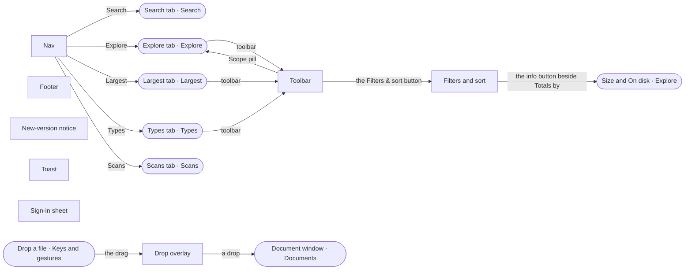
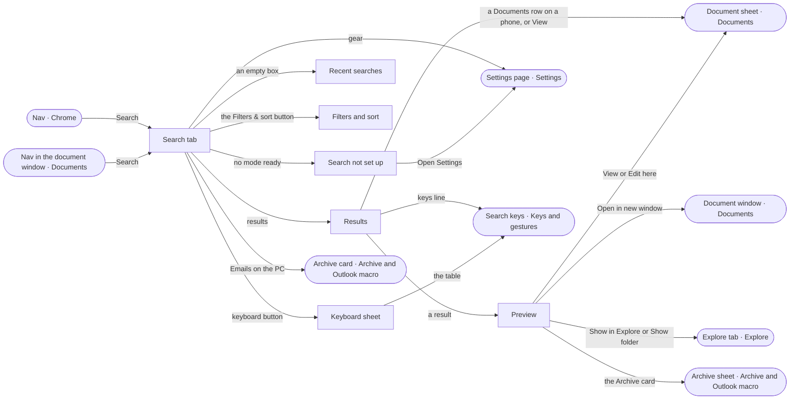
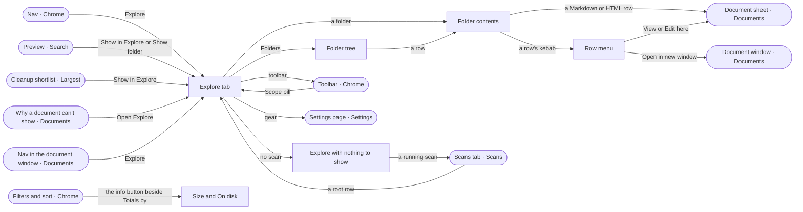
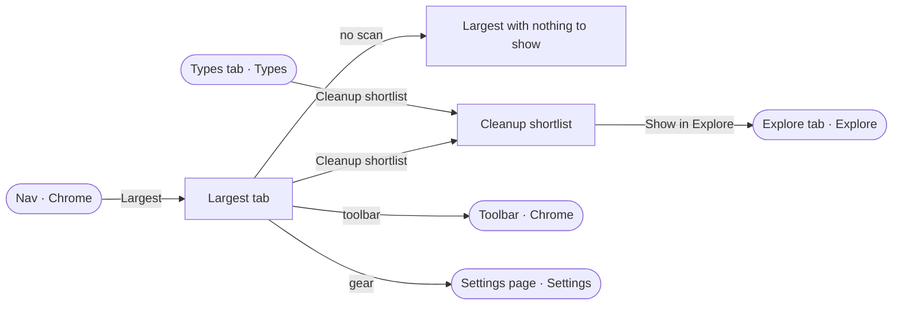
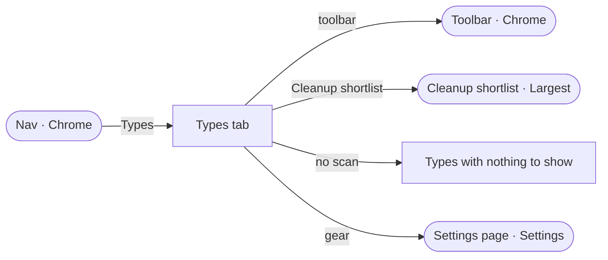
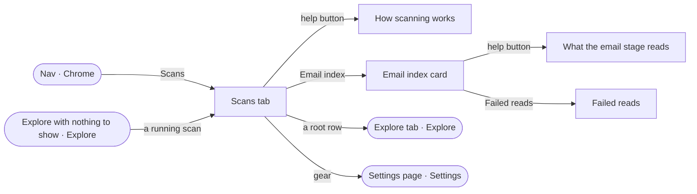
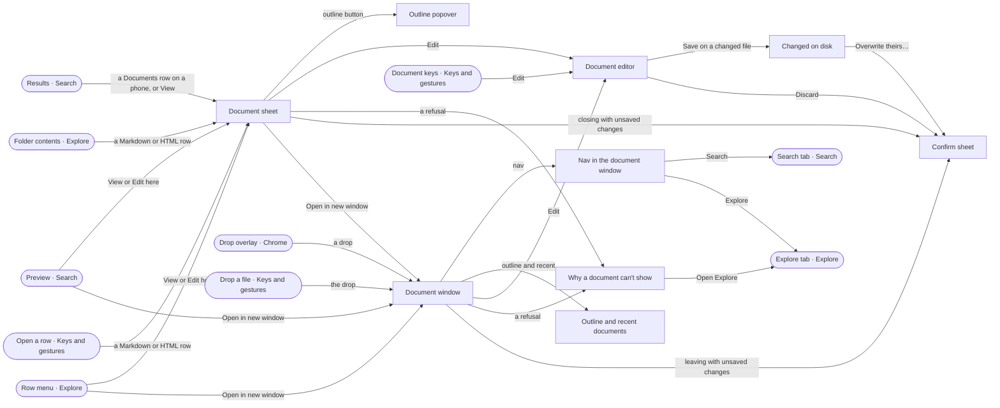
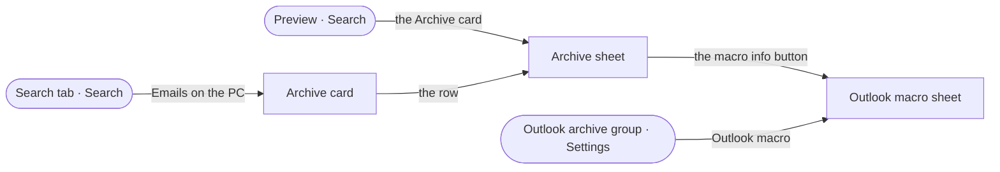
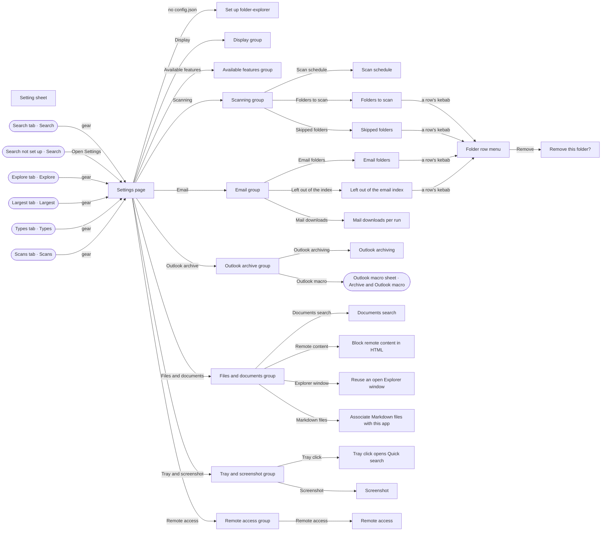
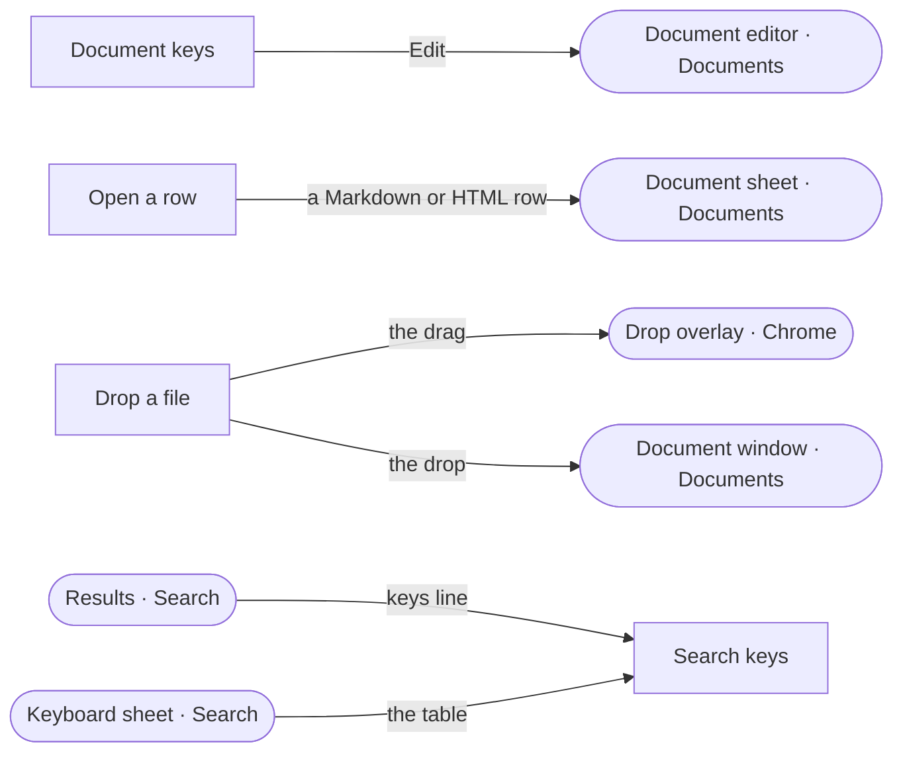

<!-- Generated from docs/ux-surfaces.yaml by scripts/ux_surface_map.py. Do not edit: change the map and re-run. -->

# UX surface map: folder-explorer

Every surface a person can reach in this app, each under a stable id that its root element carries as `data-surface`. Each area has a diagram of how its surfaces connect; a rounded node is a surface in another area.

The checklist of everything a person can see and do in folder-explorer: every tab, sheet, dialog, menu, Settings row, state, gesture and key, with how it is reached, what is on it and what each control does. [README](../README.md) tells what the app is; this page is the exhaustive index, so a layout change can check every surface and not only the ones a reviewer happens to open.

**Keeping it true.** A change that adds, removes, renames or reshapes a user-visible surface (a tab, sheet, dialog, popover, menu, menu item, Settings row, gesture or key) updates its entry in `docs/ux-surfaces.yaml` in the same change and regenerates this page with `python scripts/ux_surface_map.py`; this page is never edited by hand. The rule is in `CLAUDE.md`.

**Ids.** `<area>.<surface>`, lowercase words joined by `.` or `-`, the same form the e2e `surface(page, "<id>")` hook takes. An id never changes when a title is reworded or entries are reordered, and one id names one surface even when it is drawn two ways (Explore's contents are a pane beside the tree on a wide desktop and a sheet elsewhere: both are `explore.contents`). The surface's root element carries the same id as `data-surface`; the vendored row menu builds its own element, so its call sites stamp the id on what `attach` returns. `scripts/ux_surface_ratchet.py` fails a surface root without an id, an id without an entry, an entry no element carries, an id on two roots, a link to an id with no entry and a page that is not what the map generates. It reads markup and JS, so the entries marked `none` are held by this map and the e2e walk alone.

## Ground rules

**Five tabs, one gear.** The nav is Search · Explore · Largest · Types · Scans. Settings is the gear in each tab's header, one tap from every tab, and is not a tab. The `/doc` window is a page of its own with the same nav, but no tab is selected there.

**Layout bands.** The same markup, three placements:

| Band | Condition | Nav | Search preview and Explore contents |
| --- | --- | --- | --- |
| Phone | a touch pointer up to 520px | floating bottom pill, hidden under a sheet | a sheet over the tab |
| Narrow or mid window | a mouse below 1100px, or a touch device wider than 520px | an inline tab bar | a sheet over the tab |
| Wide | 1100px and up with a mouse | a left rail | a pane beside the list (Search) or the tree (Explore) |

Search and Explore span the window on a wide desktop; Largest, Types and Scans keep a single column.

**Input modes.** A mouse gets the keyboard hints (the `/` badge, the keys line under the results, the keyboard button) and a double-click on an Explore row. A touch screen has none of those: a tap opens a Markdown or HTML row, and everything else is in the row's kebab. Dropping a Markdown or HTML file on the window opens it on every device that can drag.

**Gating.** Four feature blocks (Settings, Available features) switch whole parts off: Email (the Emails mode, the Email index card, the Email settings group), Outlook archive (the Archive card, its group and its macro sheet), Documents (the Documents mode, the viewer, the editor and the drop target) and Screenshot (its settings row). An off block hides its screens and skips its background work.

**Who the viewer is.** On the PC itself the app opens files and folders for the caller. On any other device the menus say so and keep Copy path, and a request with no token is answered by the sign-in sheet.

**Where state lives.** The mode and the query ride the URL (`#search?mode=emails&q=…`). Per-device choices live in `localStorage`: theme, text size, the last tab, the root, the Search mode and an unsaved editor draft. Everything else (the shortlist, the saved searches, the recent documents) lives on the server.

**What this map leaves out.** The tray's own windows (the menu, Quick search, the Archive window and the region screenshot overlay) are desktop windows, not web pages; they are described in the README and docs/snap.md.

## Deep links and URL state

| Form | Opens |
| --- | --- |
| `/` | the last tab, or Search on a fresh browser |
| `/#search?mode=<folders|docs|emails>&q=<text>` | the Search tab with that mode and query |
| `/doc?root=<key>&scan=<n>&id=<n>` | the document window on that file |
| `/doc?dropped=<token>` | the document window on a dropped file the scan does not have |

## Empty, error and loading states

| Where | State | What shows |
| --- | --- | --- |
| Explore, Largest, Types | no root, a scan running for the first time, a root not on this PC, no scan yet | a centred message, and Scan now when a scan can start |
| Search | neither folder nor mail search is ready | a card naming each reason, with Open Settings |
| Search results | nothing matches | the mode's own sentence, with Clear search when there is a query |
| Search preview | no result picked | *Pick a result to preview it.* |
| Scans | no roots, a failed scan, a scan whose state cannot be told | the row's own status line in the attention or danger tone |
| Cleanup shortlist | nothing marked | *Nothing on the shortlist yet.* |
| A document | cloud-only, too large, moved, gone, not UTF-8, the connection down | the state block with its one action (see `doc.state`) |
| Any page | an action fails | a toast in the error tone |

## Where this map was checked

Every surface above was opened on a disposable instance scanned over an invented tree, with the Outlook bridge and every desktop launch switched off, so the Archive card shows its not-ready state and no open action ran. Desktop was a 1440px window with a mouse; the phone was a 390 by 844 touch-emulated page; both themes were looked at. Not driven live, only read from the code: filing a real mail from the Archive sheet, the Outlook macro import, the Markdown association in the registry, the region screenshot overlay, and remote access with a certificate.

Walked 2026-11-17 against build `62c8fc0`, at widths 390, 1440, themes light, dark.

## Areas

| Area | Surfaces |
|---|---|
| [Chrome](#chrome) | 8 |
| [Search](#search) | 7 |
| [Explore](#explore) | 6 |
| [Largest](#largest) | 3 |
| [Types](#types) | 2 |
| [Scans](#scans) | 5 |
| [Documents](#documents) | 9 |
| [Archive and Outlook macro](#archive-and-outlook-macro) | 3 |
| [Settings](#settings) | 27 |
| [Keys and gestures](#keys-and-gestures) | 4 |

## Chrome

What every tab shares: the nav, the toolbar, the footer, toasts, the update banner, the sign-in sheet and the drop overlay.

### `chrome.nav` Nav

- **Root:** `data-surface`
- **Reach:** always on screen on the five tabs
- **Holds:** one tab each for Search, Explore, Largest, Types and Scans
- **Does:** switches the tab and remembers it on this device
- **Phone:** a floating pill at the bottom, hidden while a sheet is open
- **Desktop:** an inline tab bar, or a left rail from 1100px with a mouse
- **Why:** the fleet navigation contract
- **Leads to:**
  - [Search tab](#searchtab-search-tab) (Search)
  - [Explore tab](#exploretab-explore-tab) (Explore)
  - [Largest tab](#largesttab-largest-tab) (Largest)
  - [Types tab](#typestab-types-tab) (Types)
  - [Scans tab](#scanstab-scans-tab) (Scans)

### `chrome.toolbar` Toolbar

- **Root:** `data-surface`
- **Reach:** the top of Explore, Largest and Types; one toolbar that moves into the active tab
- **Holds:**
  - Scope: the folder the three tabs show, as a pill that jumps to Explore
  - a Filters & sort button that shows how many settings differ from their default, and names them for a screen reader
- **States:** absent on Search and Scans
- **Leads to:**
  - [Filters and sort](#chromefilters-filters-and-sort) (the Filters & sort button)
  - [Explore tab](#exploretab-explore-tab) (Scope pill)

### `chrome.filters` Filters and sort

- **Root:** `data-surface`
- **Reach:** the Filters & sort button in the toolbar of Explore, Largest and Types
- **Holds:**
  - Scan root: the scanned root to show
  - Totals by: Size or On disk, with an info button
  - File type: the file type filter
  - Clear and Done
- **Does:**
  - each choice applies as it changes and reloads the three tabs for the same folder
  - Clear returns to the first root, every type and Totals by On disk
- **States:** the title and the Clear and Done footer stay in view while the settings scroll
- **Leads to:** [Size and On disk](#exploresizes-info-size-and-on-disk) (the info button beside Totals by)

### `chrome.footer` Footer

- **Root:** `data-surface`
- **Reach:** the bottom of the page, under every tab
- **Holds:** the build the page runs (the git sha and when it was built)
- **States:** reads *Build: unknown* when the version cannot be read

### `app.update-banner` New-version notice

- **Root:** `data-surface`
- **Holds:**
  - (stamped by the vendored build-watch component itself).
  - a banner offering Reload when the server moved to a newer build while the page stayed open; it never reloads by itself, so an unsaved draft survives

### `chrome.toast` Toast

- **Root:** none — built by the vendored toast component, which stamps no id; one element appended to the body
- **Reach:** after an action (copied, opened, scan started or finished, saved) or an error
- **Holds:** one message line, in the error tone for a failure
- **States:**
  - a message with an action (Undo-style) stays up longer
  - joins the top layer as a popover when a drop opened a sheet, so it shows above it

### `chrome.sign-in` Sign-in sheet

- **Root:** none — built by the vendored sign-in component, which stamps no id; a dialog appended to the body
- **Reach:** any request answered 401 from a device that is not the PC
- **Holds:** a password field and a sign-in button
- **Does:** trades the password for a token the page keeps, then repeats the request
- **States:**
  - no close button and no Esc: the app cannot be used signed out
  - wrong password, locked out for a while, or not set up each say so

### `chrome.drop-overlay` Drop overlay

- **Root:** `data-surface`
- **Reach:** dragging a file over the app window or the document window
- **Holds:** *Drop a Markdown or HTML file to open it* and a line on what opens (for editing wherever the file is where the browser gives a handle, else for editing only when the scan has it)
- **Does:** the drop opens an indexed document for editing, and any other for editing too when the browser gives its file handle (read-only otherwise), in its own window
- **States:** absent while the Documents block is off
- **Why:** it is a popover in the top layer so it shows above an open sheet
- **Leads to:** [Document window](#docwindow-document-window) (a drop)

## Search

One box over folders, documents or emails, with a preview beside the results or in a sheet.

### `search.tab` Search tab

- **Root:** `data-surface`
- **Reach:**
  - nav, Search
  - `/#search?mode=…&q=…`
  - the default tab on a fresh browser
- **Holds:**
  - the header (title, a status line, the theme toggle, the Settings gear)
  - a Folders / Documents / Emails switch, shown when more than one mode is ready
  - the search box, with a Filters & sort button beside it (hidden in Documents) and a keyboard button and a `/` badge on a mouse
  - the active operator chips under the box
  - the saved searches and Bookmark query
  - the results and preview parts
- **Does:**
  - typing searches after a short pause; Enter, a chip, a filter or a facet searches at once
  - a mode switch keeps each mode's own query
  - Bookmark query saves the box as a named search; a saved chip runs it, its × forgets it
- **States:** the header status counts the results, or says *Search is off* or *Some filters left out*
- **Leads to:**
  - [Search not set up](#searchoff-search-not-set-up) (no mode ready)
  - [Recent searches](#searchrecent-recent-searches) (an empty box)
  - [Filters and sort](#searchfilters-filters-and-sort) (the Filters & sort button)
  - [Results](#searchresults-results) (results)
  - [Keyboard sheet](#searchkeys-keyboard-sheet) (keyboard button)
  - [Archive card](#archivecard-archive-card) (Emails on the PC)
  - [Settings page](#settingssheet-settings-page) (gear)

### `search.off` Search not set up

- **Root:** `data-surface`
- **Reach:** neither the folder index nor the email index is ready
- **Holds:**
  - a sentence naming each reason
  - Open Settings
- **Leads to:** [Settings page](#settingssheet-settings-page) (Open Settings)

### `search.recent` Recent searches

- **Root:** `data-surface`
- **Reach:** an empty search box in a mode that has recent queries
- **Holds:**
  - a foldable Recent bar with the count and Clear
  - each recent query, with a × to drop it
- **Does:** a recent query fills the box and searches; Clear empties the list for the mode; the bar folds it and the choice is kept
- **States:** hidden while the box has text

### `search.filters` Filters and sort

- **Root:** `data-surface`
- **Reach:**
  - the Filters & sort button beside the search box, which shows how many settings differ from their default
  - hidden in Documents
- **Holds:**
  - Emails: Sort (Best match, Newest), Date (Any, 30 days, This year, Range with After and Before), From, To, Cc, Subject or topic, Attachment name, In folder, Size, Has an attachment, Flagged only
  - Emails, Refine: facet chips for Sender, Folder, Year and Has (Attachments, Flagged), each with its count
  - Folders: Hide leading levels (a stepper), One result per folder of people, Show OneDrive folders once
  - Clear and Done
- **Does:**
  - every filter writes its operator into the box and the box searches, so the two never disagree
  - a facet chip adds or removes its operator in the box
  - the folder options save to config.json
  - Clear takes the operators out of the box and sorts by best match, or restores the folder options
- **States:**
  - *Nothing to refine yet.* when the results have no facets
  - the title and the Clear and Done footer stay in view while the settings scroll

### `search.results` Results

- **Root:** `data-surface`
- **Reach:** the results card under the box
- **Holds:**
  - the count
  - one row per result (a mail, a folder or a document) as a listbox; a folder or mail row below the exact hits carries its tier (Partial, Similar or Closest), and a mail row found by words its score
  - Show next results
  - on a mouse, a keys line naming the shortcuts
- **Does:**
  - a row selects it and shows its preview; on a phone it opens the sheet
  - j and k move, Enter opens the preview sheet (see keys.search)
- **States:**
  - a folder box with no text asks for part of a folder name
  - folder and mail results come in tiers, never mixed: every word, then at least half, then a near spelling, then (only when nothing matched) the closest ones
  - a capped mail list reads *Best N results*
  - no match says so, with Clear search
  - notes above the rows say what a filter left out or that a root needs a rescan
- **Leads to:**
  - [Preview](#searchpreview-preview) (a result)
  - [Document sheet](#docsheet-document-sheet) (a Documents row on a phone, or View)
  - [Search keys](#keyssearch-search-keys) (keys line)

### `search.preview` Preview

- **Root:** `data-surface`
- **Reach:**
  - the pane beside the results on a wide desktop
  - a sheet over the tab on a phone or a narrow window
- **Holds:**
  - a mail: subject, flags, From, To, Cc, Date, Folder, Size, attachments, the indexed preview, Show all, then Open in Outlook, Show folder, Open folder, Copy path and Find in mailbox
  - a folder: its name and path, Size, On disk, Files and Root or People, then Open in File Explorer, Show in Explore and Copy path
  - a document: its name, folder, size and modified time, then View, Edit here, Open in new window, Show in Explore, Copy path and Open in default app
- **Does:**
  - Show all reads the whole mail in a child process; an HTML mail draws in a sandboxed frame with a Light or Dark look button and a Load remote images switch (off by default)
  - the open actions work on the PC; elsewhere a line says so
- **States:**
  - Show all: idle, loading, a read error with Try again for a timeout, or not set up
  - an online-only mail says it downloads from OneDrive
  - *Pick a result to preview it.* when nothing is selected
- **Why:** the preview reads the index; only Show all opens a mail, one at a time
- **Leads to:**
  - [Document sheet](#docsheet-document-sheet) (View or Edit here)
  - [Document window](#docwindow-document-window) (Open in new window)
  - [Explore tab](#exploretab-explore-tab) (Show in Explore or Show folder)
  - [Archive sheet](#archivesheet-archive-sheet) (the Archive card)

### `search.keys` Keyboard sheet

- **Root:** `data-surface`
- **Reach:** the keyboard button beside the mode switch (mouse only)
- **Holds:** the shortcut table for Search
- **Does:** closes with ×, Esc or a tap outside
- **Leads to:** [Search keys](#keyssearch-search-keys) (the table)

## Explore

### `explore.tab` Explore tab

- **Root:** `data-surface`
- **Reach:**
  - nav, Explore
  - a Scope pill, Show in Explore, Show folder, the shortlist's show button, or a root row on Scans
- **Holds:**
  - the header
  - the toolbar (the Scope pill and the Filters & sort button)
  - four summary cells (Total size or On disk, files and folders, online-only, On this PC)
  - the folder tree and the selected folder's contents
- **Does:** a tree row selects its folder; the twisty opens or closes it
- **States:** the tree and the contents load lazily, one folder at a time
- **Desktop:** the tree and the contents sit side by side from 1100px with a mouse
- **Leads to:**
  - [Toolbar](#chrometoolbar-toolbar) (toolbar)
  - [Folder tree](#exploretree-folder-tree) (Folders)
  - [Folder contents](#explorecontents-folder-contents) (a folder)
  - [Explore with nothing to show](#exploreempty-explore-with-nothing-to-show) (no scan)
  - [Settings page](#settingssheet-settings-page) (gear)

### `explore.empty` Explore with nothing to show

- **Root:** `data-surface`
- **Reach:** no root is set, a first scan is running, the root is not on this PC, or it has no scan yet
- **Holds:** a message, and Scan now when a scan can start
- **Does:** Scan now starts a scan of that root
- **Leads to:** [Scans tab](#scanstab-scans-tab) (a running scan)

### `explore.tree` Folder tree

- **Root:** `data-surface`
- **Reach:** the Folders card in Explore
- **Holds:**
  - a header with the file count and the column heads (Name, Share, Size, Files)
  - one row per folder with a twisty, its size, files, share and a bar; a hidden folder carries a mark
  - *and N smaller folders* at the end of a level that has more
- **Does:** a row selects the folder; the twisty expands it
- **Leads to:** [Folder contents](#explorecontents-folder-contents) (a row)

### `explore.contents` Folder contents

- **Root:** `data-surface`
- **Reach:**
  - the pane beside the tree on a wide desktop
  - a sheet that opens when a folder is chosen on a phone or a narrow window
- **Holds:**
  - the folder's path, size and file count
  - an In this folder / All nested files switch
  - a Hidden items switch, when the scan can tell hidden items apart, and a note on what the sizes include
  - column heads and one row per item (type, modified, share, size, a bar, an online-only cloud mark), each with a kebab
- **Does:**
  - a folder row selects it; a document row opens in the viewer on a tap (touch) or a double-click
  - Hidden items hides or shows hidden entries without changing the sizes
- **States:**
  - *This folder is empty.* or *Nothing here matches the type filter.*
  - *The N biggest of M items.* when the list is cut
  - the sheet closes by itself when the window grows to the wide band
- **Leads to:**
  - [Row menu](#explorerow-menu-row-menu) (a row's kebab)
  - [Document sheet](#docsheet-document-sheet) (a Markdown or HTML row)

### `explore.row-menu` Row menu

- **Root:** `data-surface`
- **Reach:** the kebab on a row in the contents (pane or sheet)
- **Holds:**
  - a folder: Open in File Explorer, Copy path
  - a Markdown or HTML file (Documents on): View, Edit here, Open in new window, Open in default app, Show in File Explorer, Copy path
  - any other file: Open, Edit, Show in File Explorer, Copy path
- **Does:**
  - the Windows actions run on the PC only and read nothing from the file
  - Copy path works on every device
- **States:** off the PC a line at the top says *Opening files and folders works on the PC*
- **Leads to:**
  - [Document sheet](#docsheet-document-sheet) (View or Edit here)
  - [Document window](#docwindow-document-window) (Open in new window)

### `explore.sizes-info` Size and On disk

- **Root:** `data-surface`
- **Reach:** the info button beside Totals by in the Filters & sort sheet
- **Holds:** what Size and On disk mean, that On disk is the default and what deleting frees, and that an online-only file takes no space until it is opened

## Largest

### `largest.tab` Largest tab

- **Root:** `data-surface`
- **Reach:** nav, Largest
- **Holds:**
  - the header and the toolbar
  - a Cleanup shortlist row with its count and size
  - Top 10 files for the selected folder, each with its rank, path, share, size and a bookmark
  - Top percentile with a Top 1% / 5% / 10% switch, the share of the space they hold and where they are
- **Does:** the bookmark marks or unmarks a file for the shortlist
- **States:** *No files in this folder.* or *No files match the type filter.*
- **Leads to:**
  - [Toolbar](#chrometoolbar-toolbar) (toolbar)
  - [Cleanup shortlist](#largestshortlist-cleanup-shortlist) (Cleanup shortlist)
  - [Largest with nothing to show](#largestempty-largest-with-nothing-to-show) (no scan)
  - [Settings page](#settingssheet-settings-page) (gear)

### `largest.empty` Largest with nothing to show

- **Root:** `data-surface`
- **Reach:** the same cases as explore.empty
- **Holds:** a message, and Scan now when a scan can start

### `largest.shortlist` Cleanup shortlist

- **Root:** `data-surface`
- **Reach:** the Cleanup shortlist row on Largest or on Types
- **Holds:**
  - the count and total size
  - one row per marked file with its folder, size, Show in Explore and Remove
  - *Marking a file only lists it here. Nothing is moved or deleted.*
- **Does:**
  - Show in Explore closes the sheet and opens the file's folder
  - Remove takes the file off the list
- **States:**
  - *Nothing on the shortlist yet.* when empty
  - a file the latest scan no longer has stays listed as gone
- **Why:** the list lives on the server so the phone and the PC share it, and it is a list only
- **Leads to:** [Explore tab](#exploretab-explore-tab) (Show in Explore)

## Types

### `types.tab` Types tab

- **Root:** `data-surface`
- **Reach:** nav, Types
- **Holds:**
  - the header and the toolbar
  - a Cleanup shortlist row
  - By file type, with a share bar, a Filter types box and one row per extension (files, share, size)
  - a filter line with Clear filter while a type is set
- **Does:** a type row sets the filter for every tab; tapping it again clears it
- **States:** *And N smaller types.* when the list is cut
- **Leads to:**
  - [Toolbar](#chrometoolbar-toolbar) (toolbar)
  - [Cleanup shortlist](#largestshortlist-cleanup-shortlist) (Cleanup shortlist)
  - [Types with nothing to show](#typesempty-types-with-nothing-to-show) (no scan)
  - [Settings page](#settingssheet-settings-page) (gear)

### `types.empty` Types with nothing to show

- **Root:** `data-surface`
- **Reach:** the same cases as explore.empty
- **Holds:** a message, and Scan now when a scan can start

## Scans

### `scans.tab` Scans tab

- **Root:** `data-surface`
- **Reach:** nav, Scans
- **Holds:**
  - the header, whose status line says what is scanning or when the last scan finished
  - Scan roots, with a help button and one row per root (its kind, status line and a refresh button)
  - Rescan all roots
  - the Email index card (Email block on)
  - a line naming the roots being scanned
- **Does:**
  - a root row opens that root in Explore; its refresh button rescans it
  - the page polls every two seconds while a scan runs
- **States:**
  - *Not scanned yet*, *Folder not found*, *Last scan failed* or *stopped early*, and *Cannot tell whether a scan is running* each in the attention tone
  - the buttons are disabled while a scan runs or its state is unknown
- **Leads to:**
  - [How scanning works](#scansinfo-how-scanning-works) (help button)
  - [Email index card](#scansemail-email-index-card) (Email index)
  - [Explore tab](#exploretab-explore-tab) (a root row)
  - [Settings page](#settingssheet-settings-page) (gear)

### `scans.info` How scanning works

- **Root:** `data-surface`
- **Reach:** the help button beside Scan roots
- **Holds:** how a scan reads folder listings only, replaces the index when it finishes and never follows links

### `scans.email` Email index card

- **Root:** `data-surface`
- **Reach:** the Email index card on Scans (Email block on)
- **Holds:**
  - the indexed count
  - stat cells for Indexed, New or changed, Downloaded, Waiting for budget and Failed reads
  - a note on what is set up
  - an Email folder select with Index this folder, and Index emails now
  - Recent runs, with a progress bar and counts for a live run
- **Does:**
  - Failed reads opens the list of failed files
  - the card polls while an index run is going and the Scans tab is on screen
- **States:**
  - *No email folders yet*, *Not set up here*, *Indexing is off here* and *Cannot tell whether an index run is going* disable the buttons and say why
  - *No runs yet.* before the first run
- **Leads to:**
  - [What the email stage reads](#scansemail-info-what-the-email-stage-reads) (help button)
  - [Failed reads](#scansfailures-failed-reads) (Failed reads)

### `scans.email-info` What the email stage reads

- **Root:** `data-surface`
- **Reach:** the help button on the Email index card
- **Holds:** which files the stage reads, that an online-only file is downloaded, that files are opened read-only and that a failed file is not read again until it changes

### `scans.failures` Failed reads

- **Root:** `data-surface`
- **Reach:** the Failed reads cell of the Email index card
- **Holds:** the newest failed files with each reason, and how many there are in all
- **States:** *No failed reads.*

## Documents

The Markdown and HTML viewer and editor, in a sheet over the app and in its own window. Behind the Documents feature block.

### `doc.sheet` Document sheet

- **Root:** `data-surface`
- **Reach:**
  - View or Edit here from the Search preview or an Explore row menu
  - a tap on a Markdown or HTML row on a touch screen, or a double-click
  - a dropped file inside the app
- **Holds:**
  - a header with Back, the file's name, an outline button, Save (in Edit), Open in new window and ×
  - a View / Edit switch and the file's place
  - the document, or the editor
- **Does:**
  - a relative link to another scanned document opens in the same sheet, and Back returns
  - an HTML page draws in a frame sandboxed without allow-same-origin
  - Esc in Edit goes back to View; closing with unsaved changes asks first
- **States:**
  - a dropped file the scan does not have is shown read-only with a note, or with Edit and a note that Save writes it back to the file when the browser gave its handle; it has no Open in new window
  - Save on such a file asks the browser for write permission (once per file), and a refusal keeps the draft
  - a state block when it cannot show (see doc.state)
- **Why:** the sheet never sends a path; every document is named by root, scan id and item id
- **Leads to:**
  - [Outline popover](#docoutline-outline-popover) (outline button)
  - [Document editor](#doceditor-document-editor) (Edit)
  - [Why a document can't show](#docstate-why-a-document-cant-show) (a refusal)
  - [Confirm sheet](#docconfirm-confirm-sheet) (closing with unsaved changes)
  - [Document window](#docwindow-document-window) (Open in new window)

### `doc.outline` Outline popover

- **Root:** `data-surface`
- **Reach:** the outline button in the document sheet's header, when the document has headings
- **Holds:** the document's headings as in-page links, indented by level
- **Does:** a heading scrolls the document to it and closes the popover
- **States:** *No headings*

### `doc.state` Why a document can't show

- **Root:** none — a block drawn inside the document sheet or window in place of the document
- **Reach:** the file is cloud-only, too large, moved, gone, not a Markdown or HTML file, not UTF-8, unreadable, the scan was renumbered, or the connection is down
- **Holds:**
  - the refusal's sentence and a line saying what to do
  - one action where one helps (Download and open, Open Explore or Reload)
- **Does:** Download and open is the one tap that brings a cloud-only file to the PC
- **Why:** a cloud-only file is never opened without that tap, so nothing hydrates by accident
- **Leads to:** [Explore tab](#exploretab-explore-tab) (Open Explore)

### `doc.editor` Document editor

- **Root:** `data-surface`
- **Reach:** Edit in the document sheet or window, or Edit here
- **Holds:**
  - a Write / Preview switch (a narrow window), a formatting toolbar for Markdown, a status line and Discard
  - the source, with a live preview beside it on a wide desktop
  - a row of Markdown keys above the keyboard on a phone
- **Does:**
  - Save, or Ctrl+S, writes the file after checking it has not changed on disk
  - the draft stays on this device until it is saved or discarded
- **States:**
  - an HTML file is plain source with a framed preview and no Markdown tools
  - a file over 1 MB, not UTF-8 or not editable opens read-only
- **Leads to:**
  - [Changed on disk](#docconflict-changed-on-disk) (Save on a changed file)
  - [Confirm sheet](#docconfirm-confirm-sheet) (Discard)

### `doc.conflict` Changed on disk

- **Root:** `data-surface`
- **Reach:** Save when the file changed on disk since the editor opened it
- **Holds:**
  - *Changed on disk since you opened it* and that the text is not lost
  - Compare, Copy my text, Load theirs and Overwrite theirs…
  - a line diff of the two copies after Compare
- **Does:** Overwrite theirs… asks first and keeps the replaced copy as a backup in the app's data folder; for a dropped file saved through the browser it says the copy is not kept
- **Leads to:** [Confirm sheet](#docconfirm-confirm-sheet) (Overwrite theirs…)

### `doc.confirm` Confirm sheet

- **Root:** `data-surface`
- **Reach:**
  - leaving the editor with unsaved changes (Discard, Keep draft or Save)
  - Discard in the editor (*Discard your changes?*)
  - Overwrite theirs… on the conflict screen (*Overwrite the copy on disk?*)
- **Holds:** one question, its choices and ×
- **Does:** × or a tap outside backs out and changes nothing
- **Why:** it is built on demand and opens above an open sheet, so the sheet and the window share one copy

### `doc.window` Document window

- **Root:** `data-surface`
- **Reach:**
  - Open in new window from the sheet, an Explore row menu or the Search preview
  - `/doc?root=…&scan=…&id=…`, a bookmark or the Markdown Open with handler
  - a dropped file opened from the app
- **Holds:**
  - the header (the file's name, its folder, an outline button, Save, the theme toggle)
  - a View / Edit switch
  - the document or the editor, with the outline and recent documents beside it
- **Does:**
  - the nav leads back into the app on a tab, asking first when there are unsaved changes
  - Esc in Edit goes back to View
- **States:**
  - a dropped file has no address of its own: read-only with the mode switch hidden, or, when the browser gave its handle, with View / Edit and Save writing back to the file
  - an address that names no document says so
  - the browser asks before the window closes with unsaved changes
- **Desktop:** the outline sits beside the text from 1100px with a mouse; elsewhere it is a popover under the header
- **Leads to:**
  - [Nav in the document window](#docnav-nav-in-the-document-window) (nav)
  - [Outline and recent documents](#docside-outline-and-recent-documents) (outline and recent)
  - [Document editor](#doceditor-document-editor) (Edit)
  - [Why a document can't show](#docstate-why-a-document-cant-show) (a refusal)
  - [Confirm sheet](#docconfirm-confirm-sheet) (leaving with unsaved changes)

### `doc.nav` Nav in the document window

- **Root:** `data-surface`
- **Reach:** the top of the document window
- **Holds:** the five tabs, none selected
- **Does:** a tab opens the app on that tab
- **Leads to:**
  - [Search tab](#searchtab-search-tab) (Search)
  - [Explore tab](#exploretab-explore-tab) (Explore)

### `doc.side` Outline and recent documents

- **Root:** `data-surface`
- **Reach:** the sidebar of the document window (a popover under the header on a narrow window)
- **Holds:**
  - the outline, when the document has headings
  - Recent, the documents opened last, which the server shares across windows and devices
- **Does:** a recent document opens in this window

## Archive and Outlook macro

Behind the Outlook archive feature block; the card shows on the PC only.

### `archive.card` Archive card

- **Root:** `data-surface`
- **Reach:** Search, Emails mode, on the PC with the Outlook archive block on
- **Holds:** an Archive the open mail row with a line saying what it archives
- **Does:** opens the Archive sheet on the mail open or selected in Outlook (classic)
- **States:**
  - the line names why it is not ready, in the attention tone, and the row is disabled
  - after filing it says where the last mail went
- **Leads to:** [Archive sheet](#archivesheet-archive-sheet) (the row)

### `archive.sheet` Archive sheet

- **Root:** `data-surface`
- **Reach:**
  - the Archive card
  - the Archive button in Outlook, which hands the mail over while the page is visible
- **Holds:**
  - the mail (subject, sender, date, attachments, a foldable preview)
  - Already archived as … with an Archive a copy anyway switch, when it is
  - Suggested folders, each with a score, the reasons and an Open in File Explorer button, and an info line on how they are ranked
  - a Find a folder box with its results, a step into subfolders, Archive here and Open in File Explorer
  - Current Explorer folder
  - the Outlook category, a Date prefix choice and the name it would save as
  - a footer line about the Outlook macro
  - the Archive to … button
- **Does:** filing saves the mail into the chosen folder, closes the sheet and toasts where it went
- **States:**
  - *Couldn't open the mail*, with Try again unless the macro opened it
  - *Finding folders…* while the ranking runs, or *No folder matches this mail yet.*
  - a folder outside the email folders cannot be filed to
  - the button says Archiving… while it works and Pick a folder with no choice
- **Leads to:** [Outlook macro sheet](#archivemacro-outlook-macro-sheet) (the macro info button)

### `archive.macro` Outlook macro sheet

- **Root:** `data-surface`
- **Reach:**
  - Settings, Outlook macro
  - the macro info button on the Archive sheet
- **Holds:**
  - what the Archive button in Outlook does
  - a Prefer the window over the web app switch
  - four numbered steps (set the folder, import the macro, add it to the ribbon, restart Outlook), each with its command or text in a copyable listing
- **Does:** Copy copies a listing
- **States:** on another device the first step says to open the sheet on the PC itself

## Settings

The gear in every tab's header opens one sheet of groups; a row that holds a choice opens a second sheet over it with that setting. The Settings sheet has no commit: each setting saves as it changes.

### `settings.sheet` Settings page

- **Root:** `data-surface`
- **Reach:** the gear in any tab's header
- **Holds:**
  - the first-run card, when there is no config.json
  - the groups Display, Available features, Scanning, Email, Outlook archive, Files and documents, Tray and screenshot and Remote access
- **Does:** opens as the full Settings page over the tab and closes with × or Esc
- **Leads to:**
  - [Set up folder-explorer](#settingssetup-set-up-folder-explorer) (no config.json)
  - [Display group](#settingsdisplay-display-group) (Display)
  - [Available features group](#settingsfeatures-available-features-group) (Available features)
  - [Scanning group](#settingsscanning-scanning-group) (Scanning)
  - [Email group](#settingsemail-email-group) (Email)
  - [Outlook archive group](#settingsoutlook-group-outlook-archive-group) (Outlook archive)
  - [Files and documents group](#settingsfiles-files-and-documents-group) (Files and documents)
  - [Tray and screenshot group](#settingstray-tray-and-screenshot-group) (Tray and screenshot)
  - [Remote access group](#settingsremote-group-remote-access-group) (Remote access)

### `settings.setup` Set up folder-explorer

- **Root:** `data-surface`
- **Reach:** the top of the Settings sheet while there is no config.json
- **Holds:**
  - a note that the built-in defaults are in use
  - Create config.json
- **Does:** creates config.json from config.example.json and never overwrites an existing one

### `settings.display` Display group

- **Root:** `data-surface`
- **Holds:**
  - Text size, Small, Default or Large
  - Totals by, the default basis, Size or On disk
  - Full screen on Edge, a switch that appears only in Edge
- **Does:** each applies at once; text size is kept on this device, the basis in config.json; full screen is kept on this device, off by default, and while it is on the first tap after a reload enters full screen again

### `settings.features` Available features group

- **Root:** `data-surface`
- **Holds:**
  - a switch each for Email, Outlook archive, Documents and Screenshot, with what each does and why one is not available here
  - a footnote on how a block that is off behaves
- **Does:** a block that is off hides its screens, stops its background work and skips its calls, with no restart

### `settings.scanning` Scanning group

- **Root:** `data-surface`
- **Holds:**
  - Scan schedule, Folders to scan and Skipped folders, each showing its value and opening a sheet
  - Index on this PC, the disk space the indexes use
- **Leads to:**
  - [Scan schedule](#settingsschedule-scan-schedule) (Scan schedule)
  - [Folders to scan](#settingsroots-folders-to-scan) (Folders to scan)
  - [Skipped folders](#settingsexclude-skipped-folders) (Skipped folders)

### `settings.email` Email group

- **Root:** `data-surface`
- **Reach:** the Settings sheet, Email block on
- **Holds:** Email folders, Left out of the index and Mail downloads, each showing its value and opening a sheet
- **Leads to:**
  - [Email folders](#settingsemail-roots-email-folders) (Email folders)
  - [Left out of the email index](#settingsemail-exclude-left-out-of-the-email-index) (Left out of the index)
  - [Mail downloads per run](#settingsbudget-mail-downloads-per-run) (Mail downloads)

### `settings.outlook-group` Outlook archive group

- **Root:** `data-surface`
- **Reach:** the Settings sheet, Outlook archive block on
- **Holds:**
  - Outlook archiving, showing Category and Move when they are on
  - Outlook macro, showing Ready or Not ready
- **Leads to:**
  - [Outlook archiving](#settingsoutlook-outlook-archiving) (Outlook archiving)
  - [Outlook macro sheet](#archivemacro-outlook-macro-sheet) (Outlook macro)

### `settings.files` Files and documents group

- **Root:** `data-surface`
- **Holds:**
  - Documents search and Remote content, with the Documents block on
  - Explorer window
  - Markdown files, on the PC only and with the Documents block on
- **Leads to:**
  - [Documents search](#settingsmarkdown-search-documents-search) (Documents search)
  - [Block remote content in HTML](#settingsremote-html-block-remote-content-in-html) (Remote content)
  - [Reuse an open Explorer window](#settingsexplorer-window-reuse-an-open-explorer-window) (Explorer window)
  - [Associate Markdown files with this app](#settingsmd-assoc-associate-markdown-files-with-this-app) (Markdown files)

### `settings.tray` Tray and screenshot group

- **Root:** `data-surface`
- **Holds:**
  - Tray click, showing Quick search or Open app
  - Screenshot, showing the hotkey, with the Screenshot block on
- **Leads to:**
  - [Tray click opens Quick search](#settingstray-click-tray-click-opens-quick-search) (Tray click)
  - [Screenshot](#settingsscreenshot-screenshot) (Screenshot)

### `settings.remote-group` Remote access group

- **Root:** `data-surface`
- **Holds:** Remote access, showing On or Off
- **Leads to:** [Remote access](#settingsremote-remote-access) (Remote access)

### `settings.setting` Setting sheet

- **Root:** `data-surface`
- **Reach:** any Settings row that holds a choice
- **Holds:** the one setting's control and note (see the entries below), under its own title
- **Does:** closes with ×, Esc or a tap outside, and the Settings sheet is under it

### `settings.schedule` Scan schedule

- **Root:** `data-surface`
- **Reach:** Settings, Scanning, Scan schedule
- **Holds:**
  - Schedule, Off, Every night or Every hour
  - Nightly scan time, for Every night
  - a note
- **Does:** saves as it changes

### `settings.roots` Folders to scan

- **Root:** `data-surface`
- **Reach:** Settings, Scanning, Folders to scan
- **Holds:**
  - an All drives and OneDrive switch
  - the folder list, when it is off, with its add field
  - a note
- **Does:** the list adds a path and saves at once; a row's kebab removes it
- **Leads to:** [Folder row menu](#settingsfolder-menu-folder-row-menu) (a row's kebab)

### `settings.exclude` Skipped folders

- **Root:** `data-surface`
- **Reach:** Settings, Scanning, Skipped folders
- **Holds:** the folders the disk scan, the folder search and the email index all leave out, with an add field
- **Leads to:** [Folder row menu](#settingsfolder-menu-folder-row-menu) (a row's kebab)

### `settings.email-roots` Email folders

- **Root:** `data-surface`
- **Reach:** Settings, Email, Email folders
- **Holds:** the folders whose .msg files the email index reads, with an add field
- **Leads to:** [Folder row menu](#settingsfolder-menu-folder-row-menu) (a row's kebab)

### `settings.email-exclude` Left out of the email index

- **Root:** `data-surface`
- **Reach:** Settings, Email, Left out of the index
- **Holds:** the folders inside an email folder that only the email index skips, with an add field
- **Leads to:** [Folder row menu](#settingsfolder-menu-folder-row-menu) (a row's kebab)

### `settings.budget` Mail downloads per run

- **Root:** `data-surface`
- **Reach:** Settings, Email, Mail downloads
- **Holds:**
  - Download limit, No limit, None (local only), 512 MB, 2 GB or 5 GB
  - a note on what a run does at the limit

### `settings.outlook` Outlook archiving

- **Root:** `data-surface`
- **Reach:** Settings, Outlook archive, Outlook archiving
- **Holds:**
  - an Outlook category switch and its note
  - an Also archive in Outlook switch and its note
  - a closing note

### `settings.markdown-search` Documents search

- **Root:** `data-surface`
- **Reach:** Settings, Files and documents, Documents search
- **Holds:** a Documents search switch and its note

### `settings.remote-html` Block remote content in HTML

- **Root:** `data-surface`
- **Reach:** Settings, Files and documents, Remote content
- **Holds:** a Block remote content switch and its note

### `settings.explorer-window` Reuse an open Explorer window

- **Root:** `data-surface`
- **Reach:** Settings, Files and documents, Explorer window
- **Holds:** a Reuse an open window switch and its note

### `settings.md-assoc` Associate Markdown files with this app

- **Root:** `data-surface`
- **Reach:** Settings, Files and documents, Markdown files (the PC only)
- **Holds:** an Open with this app switch and a note saying what the registry holds
- **States:**
  - the row is hidden off the PC
  - the switch is disabled when the state cannot be read, and the note says so

### `settings.tray-click` Tray click opens Quick search

- **Root:** `data-surface`
- **Reach:** Settings, Tray and screenshot, Tray click
- **Holds:** an Opens Quick search switch and its note

### `settings.screenshot` Screenshot

- **Root:** `data-surface`
- **Reach:** Settings, Tray and screenshot, Screenshot (Screenshot block on)
- **Holds:**
  - Hold to capture, Copy to clipboard and Show loupe switches
  - JPEG quality, File prefix and Hotkey
  - Save folder, with Open folder on the PC
  - a note under each
- **Does:**
  - every setting applies from the next capture, except the hotkey, which applies when the tray next starts
  - the save folder is changed from the tray menu or config.json, never from this page

### `settings.remote` Remote access

- **Root:** `data-surface`
- **Reach:** Settings, Remote access
- **Holds:** a Remote access switch and a note on the address and sign-in it opens

### `settings.folder-menu` Folder row menu

- **Root:** `data-surface`
- **Reach:** the kebab on a row of any folder list
- **Holds:** Remove
- **Does:** Remove asks first
- **Leads to:** [Remove this folder?](#settingsfolder-remove-remove-this-folder) (Remove)

### `settings.folder-remove` Remove this folder?

- **Root:** `data-surface`
- **Reach:** Remove in a folder list's row menu
- **Holds:**
  - the folder's path
  - *Only the list changes: the folder and everything in it stay on disk.*
  - Remove
- **Does:** × or a tap outside backs out and changes nothing

## Keys and gestures

### `keys.search` Search keys

- **Root:** none — keyboard paths on the Search tab, with no element of their own; the keyboard sheet lists them
- **Reach:** the Search tab, with focus outside a field and no sheet open
- **Holds:**
  - / goes to the search box; the down arrow moves from the box into the results
  - j and k move between results; Enter opens the preview sheet
  - a shows all of a mail; o opens it in Outlook (this PC); e opens the folder in File Explorer (this PC); f shows the folder in Explore; c copies the path
  - Esc goes back to the search box
- **States:** Documents: e opens in the default app (this PC); Folders: e opens in File Explorer (this PC)

### `keys.doc` Document keys

- **Root:** none — keyboard paths in the viewer and editor, with no element of their own
- **Reach:** the document sheet and window
- **Holds:**
  - Esc in Edit goes back to View
  - Ctrl+S or Cmd+S saves the editor
- **Leads to:** [Document editor](#doceditor-document-editor) (Edit)

### `keys.double-click` Open a row

- **Root:** none — a gesture on Explore's contents rows, with no element of its own
- **Reach:** a double-click on a row (a mouse), a tap on a Markdown or HTML row (touch)
- **Holds:**
  - a folder row opens in File Explorer and a file in its default app, on the PC only
  - a Markdown or HTML row opens in the document sheet on every device
- **Leads to:** [Document sheet](#docsheet-document-sheet) (a Markdown or HTML row)

### `keys.drop-file` Drop a file

- **Root:** none — a gesture on the window; the overlay it shows is chrome.drop-overlay
- **Reach:** dragging a Markdown or HTML file onto the app window or the document window
- **Holds:**
  - a file the scan has opens as an indexed document, with Edit
  - any other opens read-only from the text the page read, with a note saying why
  - anything else is refused with a toast
- **Leads to:**
  - [Drop overlay](#chromedrop-overlay-drop-overlay) (the drag)
  - [Document window](#docwindow-document-window) (the drop)

## Link index

| From | Via | To |
|---|---|---|
| [Nav](#chromenav-nav) | Search | [Search tab](#searchtab-search-tab) |
| [Nav](#chromenav-nav) | Explore | [Explore tab](#exploretab-explore-tab) |
| [Nav](#chromenav-nav) | Largest | [Largest tab](#largesttab-largest-tab) |
| [Nav](#chromenav-nav) | Types | [Types tab](#typestab-types-tab) |
| [Nav](#chromenav-nav) | Scans | [Scans tab](#scanstab-scans-tab) |
| [Toolbar](#chrometoolbar-toolbar) | the Filters & sort button | [Filters and sort](#chromefilters-filters-and-sort) |
| [Toolbar](#chrometoolbar-toolbar) | Scope pill | [Explore tab](#exploretab-explore-tab) |
| [Filters and sort](#chromefilters-filters-and-sort) | the info button beside Totals by | [Size and On disk](#exploresizes-info-size-and-on-disk) |
| [Drop overlay](#chromedrop-overlay-drop-overlay) | a drop | [Document window](#docwindow-document-window) |
| [Search tab](#searchtab-search-tab) | no mode ready | [Search not set up](#searchoff-search-not-set-up) |
| [Search tab](#searchtab-search-tab) | an empty box | [Recent searches](#searchrecent-recent-searches) |
| [Search tab](#searchtab-search-tab) | the Filters & sort button | [Filters and sort](#searchfilters-filters-and-sort) |
| [Search tab](#searchtab-search-tab) | results | [Results](#searchresults-results) |
| [Search tab](#searchtab-search-tab) | keyboard button | [Keyboard sheet](#searchkeys-keyboard-sheet) |
| [Search tab](#searchtab-search-tab) | Emails on the PC | [Archive card](#archivecard-archive-card) |
| [Search tab](#searchtab-search-tab) | gear | [Settings page](#settingssheet-settings-page) |
| [Search not set up](#searchoff-search-not-set-up) | Open Settings | [Settings page](#settingssheet-settings-page) |
| [Results](#searchresults-results) | a result | [Preview](#searchpreview-preview) |
| [Results](#searchresults-results) | a Documents row on a phone, or View | [Document sheet](#docsheet-document-sheet) |
| [Results](#searchresults-results) | keys line | [Search keys](#keyssearch-search-keys) |
| [Preview](#searchpreview-preview) | View or Edit here | [Document sheet](#docsheet-document-sheet) |
| [Preview](#searchpreview-preview) | Open in new window | [Document window](#docwindow-document-window) |
| [Preview](#searchpreview-preview) | Show in Explore or Show folder | [Explore tab](#exploretab-explore-tab) |
| [Preview](#searchpreview-preview) | the Archive card | [Archive sheet](#archivesheet-archive-sheet) |
| [Keyboard sheet](#searchkeys-keyboard-sheet) | the table | [Search keys](#keyssearch-search-keys) |
| [Explore tab](#exploretab-explore-tab) | toolbar | [Toolbar](#chrometoolbar-toolbar) |
| [Explore tab](#exploretab-explore-tab) | Folders | [Folder tree](#exploretree-folder-tree) |
| [Explore tab](#exploretab-explore-tab) | a folder | [Folder contents](#explorecontents-folder-contents) |
| [Explore tab](#exploretab-explore-tab) | no scan | [Explore with nothing to show](#exploreempty-explore-with-nothing-to-show) |
| [Explore tab](#exploretab-explore-tab) | gear | [Settings page](#settingssheet-settings-page) |
| [Explore with nothing to show](#exploreempty-explore-with-nothing-to-show) | a running scan | [Scans tab](#scanstab-scans-tab) |
| [Folder tree](#exploretree-folder-tree) | a row | [Folder contents](#explorecontents-folder-contents) |
| [Folder contents](#explorecontents-folder-contents) | a row's kebab | [Row menu](#explorerow-menu-row-menu) |
| [Folder contents](#explorecontents-folder-contents) | a Markdown or HTML row | [Document sheet](#docsheet-document-sheet) |
| [Row menu](#explorerow-menu-row-menu) | View or Edit here | [Document sheet](#docsheet-document-sheet) |
| [Row menu](#explorerow-menu-row-menu) | Open in new window | [Document window](#docwindow-document-window) |
| [Largest tab](#largesttab-largest-tab) | toolbar | [Toolbar](#chrometoolbar-toolbar) |
| [Largest tab](#largesttab-largest-tab) | Cleanup shortlist | [Cleanup shortlist](#largestshortlist-cleanup-shortlist) |
| [Largest tab](#largesttab-largest-tab) | no scan | [Largest with nothing to show](#largestempty-largest-with-nothing-to-show) |
| [Largest tab](#largesttab-largest-tab) | gear | [Settings page](#settingssheet-settings-page) |
| [Cleanup shortlist](#largestshortlist-cleanup-shortlist) | Show in Explore | [Explore tab](#exploretab-explore-tab) |
| [Types tab](#typestab-types-tab) | toolbar | [Toolbar](#chrometoolbar-toolbar) |
| [Types tab](#typestab-types-tab) | Cleanup shortlist | [Cleanup shortlist](#largestshortlist-cleanup-shortlist) |
| [Types tab](#typestab-types-tab) | no scan | [Types with nothing to show](#typesempty-types-with-nothing-to-show) |
| [Types tab](#typestab-types-tab) | gear | [Settings page](#settingssheet-settings-page) |
| [Scans tab](#scanstab-scans-tab) | help button | [How scanning works](#scansinfo-how-scanning-works) |
| [Scans tab](#scanstab-scans-tab) | Email index | [Email index card](#scansemail-email-index-card) |
| [Scans tab](#scanstab-scans-tab) | a root row | [Explore tab](#exploretab-explore-tab) |
| [Scans tab](#scanstab-scans-tab) | gear | [Settings page](#settingssheet-settings-page) |
| [Email index card](#scansemail-email-index-card) | help button | [What the email stage reads](#scansemail-info-what-the-email-stage-reads) |
| [Email index card](#scansemail-email-index-card) | Failed reads | [Failed reads](#scansfailures-failed-reads) |
| [Document sheet](#docsheet-document-sheet) | outline button | [Outline popover](#docoutline-outline-popover) |
| [Document sheet](#docsheet-document-sheet) | Edit | [Document editor](#doceditor-document-editor) |
| [Document sheet](#docsheet-document-sheet) | a refusal | [Why a document can't show](#docstate-why-a-document-cant-show) |
| [Document sheet](#docsheet-document-sheet) | closing with unsaved changes | [Confirm sheet](#docconfirm-confirm-sheet) |
| [Document sheet](#docsheet-document-sheet) | Open in new window | [Document window](#docwindow-document-window) |
| [Why a document can't show](#docstate-why-a-document-cant-show) | Open Explore | [Explore tab](#exploretab-explore-tab) |
| [Document editor](#doceditor-document-editor) | Save on a changed file | [Changed on disk](#docconflict-changed-on-disk) |
| [Document editor](#doceditor-document-editor) | Discard | [Confirm sheet](#docconfirm-confirm-sheet) |
| [Changed on disk](#docconflict-changed-on-disk) | Overwrite theirs… | [Confirm sheet](#docconfirm-confirm-sheet) |
| [Document window](#docwindow-document-window) | nav | [Nav in the document window](#docnav-nav-in-the-document-window) |
| [Document window](#docwindow-document-window) | outline and recent | [Outline and recent documents](#docside-outline-and-recent-documents) |
| [Document window](#docwindow-document-window) | Edit | [Document editor](#doceditor-document-editor) |
| [Document window](#docwindow-document-window) | a refusal | [Why a document can't show](#docstate-why-a-document-cant-show) |
| [Document window](#docwindow-document-window) | leaving with unsaved changes | [Confirm sheet](#docconfirm-confirm-sheet) |
| [Nav in the document window](#docnav-nav-in-the-document-window) | Search | [Search tab](#searchtab-search-tab) |
| [Nav in the document window](#docnav-nav-in-the-document-window) | Explore | [Explore tab](#exploretab-explore-tab) |
| [Archive card](#archivecard-archive-card) | the row | [Archive sheet](#archivesheet-archive-sheet) |
| [Archive sheet](#archivesheet-archive-sheet) | the macro info button | [Outlook macro sheet](#archivemacro-outlook-macro-sheet) |
| [Settings page](#settingssheet-settings-page) | no config.json | [Set up folder-explorer](#settingssetup-set-up-folder-explorer) |
| [Settings page](#settingssheet-settings-page) | Display | [Display group](#settingsdisplay-display-group) |
| [Settings page](#settingssheet-settings-page) | Available features | [Available features group](#settingsfeatures-available-features-group) |
| [Settings page](#settingssheet-settings-page) | Scanning | [Scanning group](#settingsscanning-scanning-group) |
| [Settings page](#settingssheet-settings-page) | Email | [Email group](#settingsemail-email-group) |
| [Settings page](#settingssheet-settings-page) | Outlook archive | [Outlook archive group](#settingsoutlook-group-outlook-archive-group) |
| [Settings page](#settingssheet-settings-page) | Files and documents | [Files and documents group](#settingsfiles-files-and-documents-group) |
| [Settings page](#settingssheet-settings-page) | Tray and screenshot | [Tray and screenshot group](#settingstray-tray-and-screenshot-group) |
| [Settings page](#settingssheet-settings-page) | Remote access | [Remote access group](#settingsremote-group-remote-access-group) |
| [Scanning group](#settingsscanning-scanning-group) | Scan schedule | [Scan schedule](#settingsschedule-scan-schedule) |
| [Scanning group](#settingsscanning-scanning-group) | Folders to scan | [Folders to scan](#settingsroots-folders-to-scan) |
| [Scanning group](#settingsscanning-scanning-group) | Skipped folders | [Skipped folders](#settingsexclude-skipped-folders) |
| [Email group](#settingsemail-email-group) | Email folders | [Email folders](#settingsemail-roots-email-folders) |
| [Email group](#settingsemail-email-group) | Left out of the index | [Left out of the email index](#settingsemail-exclude-left-out-of-the-email-index) |
| [Email group](#settingsemail-email-group) | Mail downloads | [Mail downloads per run](#settingsbudget-mail-downloads-per-run) |
| [Outlook archive group](#settingsoutlook-group-outlook-archive-group) | Outlook archiving | [Outlook archiving](#settingsoutlook-outlook-archiving) |
| [Outlook archive group](#settingsoutlook-group-outlook-archive-group) | Outlook macro | [Outlook macro sheet](#archivemacro-outlook-macro-sheet) |
| [Files and documents group](#settingsfiles-files-and-documents-group) | Documents search | [Documents search](#settingsmarkdown-search-documents-search) |
| [Files and documents group](#settingsfiles-files-and-documents-group) | Remote content | [Block remote content in HTML](#settingsremote-html-block-remote-content-in-html) |
| [Files and documents group](#settingsfiles-files-and-documents-group) | Explorer window | [Reuse an open Explorer window](#settingsexplorer-window-reuse-an-open-explorer-window) |
| [Files and documents group](#settingsfiles-files-and-documents-group) | Markdown files | [Associate Markdown files with this app](#settingsmd-assoc-associate-markdown-files-with-this-app) |
| [Tray and screenshot group](#settingstray-tray-and-screenshot-group) | Tray click | [Tray click opens Quick search](#settingstray-click-tray-click-opens-quick-search) |
| [Tray and screenshot group](#settingstray-tray-and-screenshot-group) | Screenshot | [Screenshot](#settingsscreenshot-screenshot) |
| [Remote access group](#settingsremote-group-remote-access-group) | Remote access | [Remote access](#settingsremote-remote-access) |
| [Folders to scan](#settingsroots-folders-to-scan) | a row's kebab | [Folder row menu](#settingsfolder-menu-folder-row-menu) |
| [Skipped folders](#settingsexclude-skipped-folders) | a row's kebab | [Folder row menu](#settingsfolder-menu-folder-row-menu) |
| [Email folders](#settingsemail-roots-email-folders) | a row's kebab | [Folder row menu](#settingsfolder-menu-folder-row-menu) |
| [Left out of the email index](#settingsemail-exclude-left-out-of-the-email-index) | a row's kebab | [Folder row menu](#settingsfolder-menu-folder-row-menu) |
| [Folder row menu](#settingsfolder-menu-folder-row-menu) | Remove | [Remove this folder?](#settingsfolder-remove-remove-this-folder) |
| [Document keys](#keysdoc-document-keys) | Edit | [Document editor](#doceditor-document-editor) |
| [Open a row](#keysdouble-click-open-a-row) | a Markdown or HTML row | [Document sheet](#docsheet-document-sheet) |
| [Drop a file](#keysdrop-file-drop-a-file) | the drag | [Drop overlay](#chromedrop-overlay-drop-overlay) |
| [Drop a file](#keysdrop-file-drop-a-file) | the drop | [Document window](#docwindow-document-window) |
